# Lonecat's H3 Showrunner 🎬: User Guide

Make a short movie with MiniMax H3: you write the story on one node, give every person and place a picture, and press **Run**. Showrunner renders the shots one after another and joins them into one movie with sound and dialogue.

This guide walks through the whole workflow, button by button. For how to *word* things (looks, outfits, actions, lines), see the [Prompting Guide](PROMPTING_GUIDE.md).

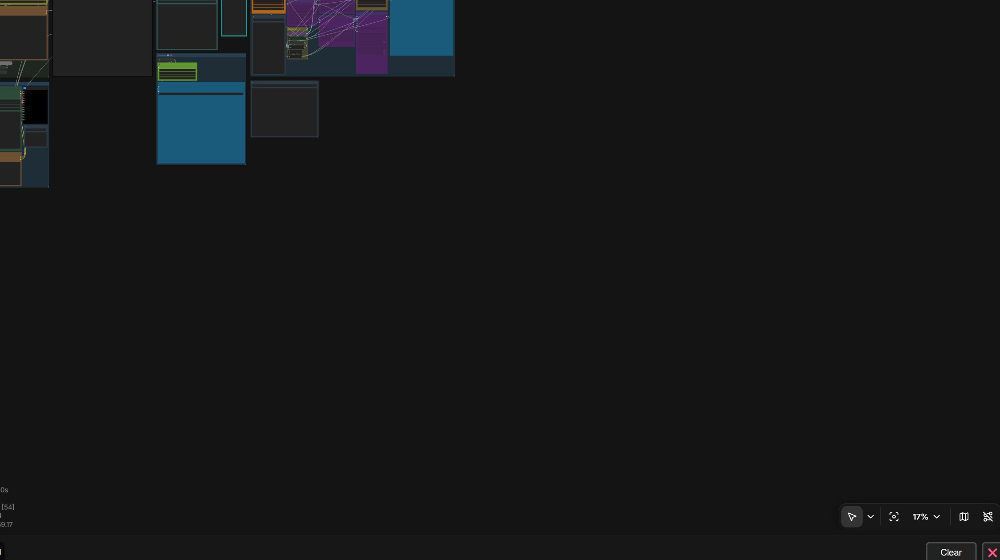

---

## Contents

- ✋ Read this first
- 1. The guided tour 🧭
- 2. Install and models
- 3. Settings and models in the workflow
- 4. The Story node 🎬
- 5. Cast 🎭 and outfits 👗
- 6. Places 📍, 360 🌐 and props 👜
- 7. Shots 🎞
- 8. Making the pictures ✨
- 9. Storyboard 🗺️ (start frames)
- 10. Making the movie 🎥
- 11. The board: play, remake, lock
- 12. Anchors 📌 and starting a shot from a frame 🖼
- 13. Post processing 🎞️
- 14. Where everything is saved
- 15. Troubleshooting

---

## ✋ Read this first

- **Do the steps in order.** Every step uses what the step before it made. Skipping ahead is the fastest way to get strangers in random rooms.
- 🛑🚫 **Don't bypass nodes by hand.** The **Cards & Storyboard 🃏** box is bypassed on the inside on purpose. The **✨** buttons switch on what they need and put it back.
- **Nothing is lost.** Every picture and every shot is saved in a project folder. Close ComfyUI, come back tomorrow, and it's all still there. Old pictures and old takes are kept too.
- **Pictures and the movie are separate Runs.** ✨ makes a picture (Make stays off for that run). **Run** makes the movie.
- ⚠️ It's a long job on a big model. 32 GB of VRAM is comfortable. Less works, just slower.
- 💡 **The guided tour** walks you through all of this inside ComfyUI (section 1).

---

## 1. The guided tour 🧭

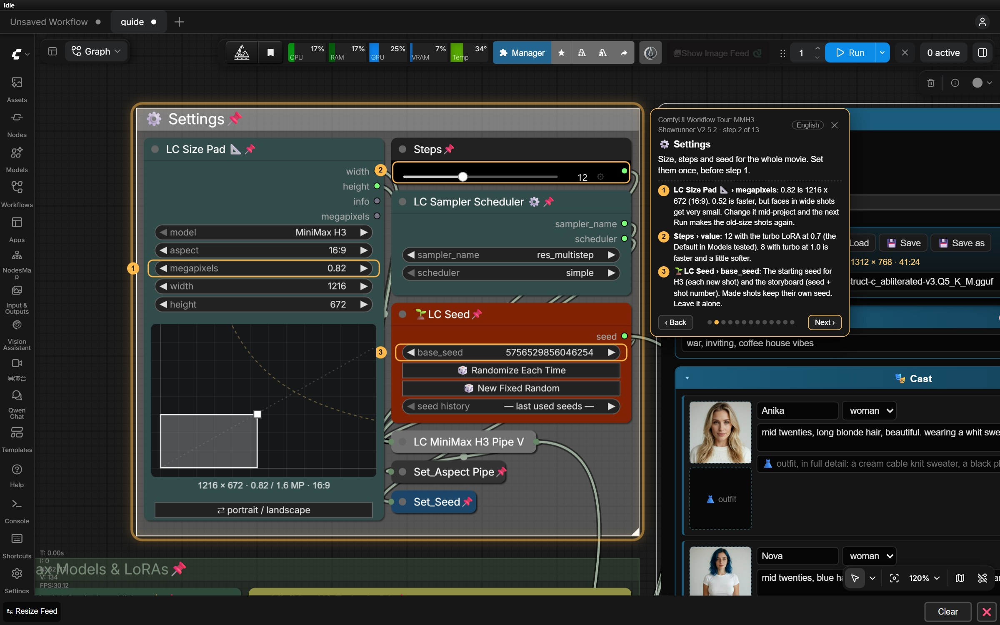

- 💡 Start here: it saves you time. Open **Vision Assistant** (left sidebar) → **Tour**. It lights up each part of the workflow in order and marks the settings that matter, with a short note for each.
- 13 steps: Start here, Settings, Models, Models tested, the Story, Cast & Outfits, Places & Props, Shots, the board, Cards & Storyboard, Make, Post Processing, Tips.
- In English, Chinese, Japanese and Korean (it follows ComfyUI's language).

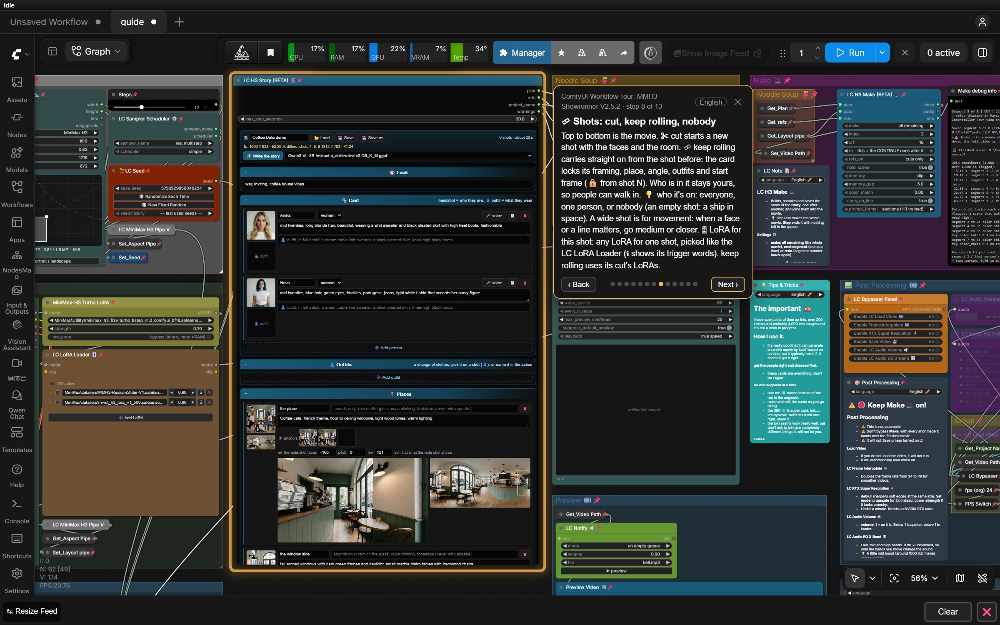

---

## 2. Install and models

**Node packs**
- **ComfyUI_LC_AV_nodes** (Story, Make, the cards and storyboard nodes)
- **ComfyUI_LC123_nodes** (Optimizer, settings, post processing)
- **ComfyUI_LC_Vision_nodes** (✨ Write the story, the guided tour). Optional, but recommended.
- **comfyui-krea2edit** (Krea 2 Identity Edit, for the storyboard)

**Models**
- 💡 The **LC Optimizer** nodes pick the right files for your card (**★ Recommended**). You only need to download them. The links are in the workflow's main note.
- **MiniMax H3** (the movie): the FL2VA model, the Qwen3-VL 32B text encoder, the H3 video and audio VAEs, and the **8-step turbo LoRA**.
- **Krea 2** (cast, places, props and storyboard pictures): Krealism V3.1 (or any Krea 2 model), its text encoder and VAE, and the **krea2 identity edit v2** LoRA.
- **MOSS Image** (storyboard layout): the SFT model, its text encoder and the **flux2-vae_small** VAE (MOSS needs this one).
- **Story writer** (optional): Qwen3-VL-8B GGUF plus its **mmproj**, in `models/LLM`. 💡 **Vision Assistant → Models** downloads it with one click.

**Downloads by themselves the first time** (a yellow message tells you, **Stop** cancels): BiRefNet (takes backgrounds off) and RIFE 4.26 (frame interpolation).

---

## 3. Settings and models in the workflow

### ⚙️ Settings

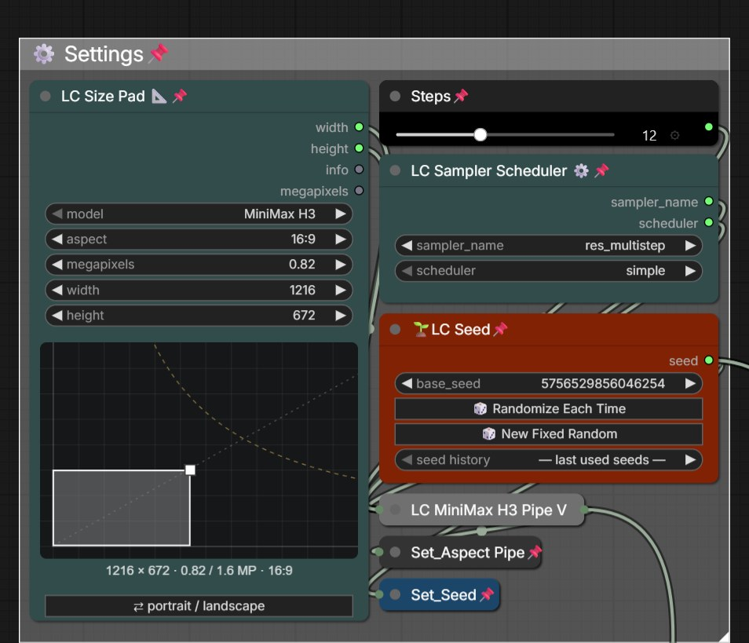

- **megapixels**: the size of the movie. 0.82 = 1216 x 672 (16:9).
    - 0.52 (960 x 544) is faster, but faces in wide shots get very small.
    - Keep one size for the whole project. Change it anyway and the next Run makes every shot made at the old size again, in order.
- **Steps**: 12 with the turbo LoRA at 0.7. 8 with turbo at 1.0 is faster and a little softer.
- **LC Seed**: the starting seed for H3 and the storyboard. Every made shot keeps its own seed. Leave it alone.

### Minimax Models & LoRAs

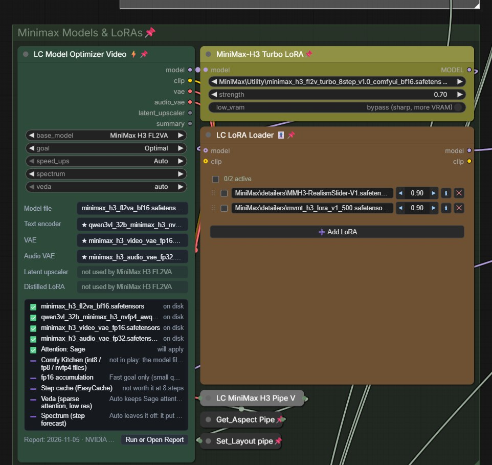

- **LC Model Optimizer**: loads H3 and picks the speed-ups for your card. Leave it on **★ Recommended**.
    - **goal**: Optimal = fast and near identical to bf16. Quality = closest to bf16. Fast = the fastest that still looks right.
- **Turbo LoRA strength**: 0.7 with 12 steps is the default. 1.0 with 8 steps is faster. Talking comes out cleanest with turbo on.
- **LC LoRA Loader**: load your base LoRAs here. They go on every shot.
- 💡 The **Models tested 🧪** note next to it has what I tested on a 5090, with times.

---

## 4. The Story node 🎬

Everything you write lives on one big node: **LC H3 Story**. It has five lists (Cast, Outfits, Places, Props, Shots) and a bar at the top.

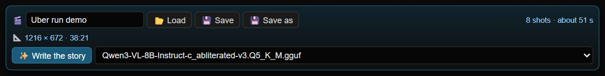

- **project name**: the folder everything is saved in (`output/LC_H3/<name>/`). ✋ Name it first.
- **📂 Load** opens a saved project. **💾 Save** saves now (every Run saves too). **💾 Save as** keeps a variant under a new name: the made shots come along, the original stays as it is.
- 💡 The bar stays pinned at the top while you scroll, so Save is always one click away.
- **📐 size** (under the name): the size this project is made at, and its aspect ratio. Shots made at another size are listed (⚠) and made again on the next Run.
- **✨ Write the story** (optional): type a short pitch ("Nova and Anika meet for coffee, Anika tells a story that goes too far, Nova leaves") and press it. A local model fills in the look, cast, places and shots once. After that it's plain text you edit.
    - **🔞 NSFW** (in the ✨ Write box, off by default): lets the writer write adult scenes, the same rule as LC Vision's NSFW style tag. Off, it writes the way it always has. Saved with the project.

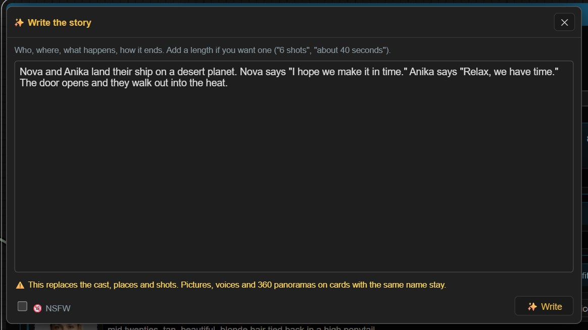


### 🎨 Look

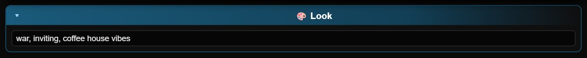

- A few words for the style of the whole movie: "cinematic, soft natural light, shallow depth of field". It goes into every shot.

### The H3 prompt: the shot's lines

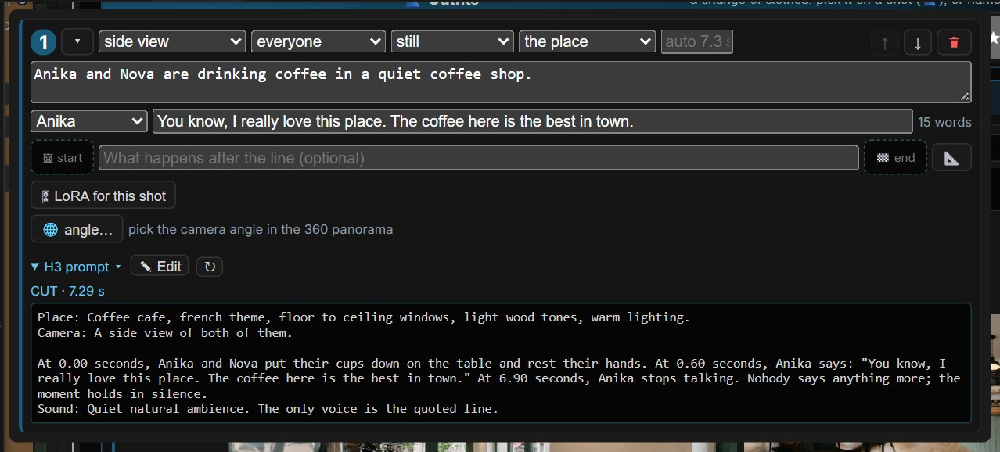

- ✋ **H3 prompt shows the shot's lines:** Place, Camera and the timed action. Open it under any shot to read them.
    - When the shot is made, Make wraps the rest around them: who each person is and which picture is theirs, what to keep from each picture, the look and the sound.
    - The full prompt of a made take is saved in `takes/seg_NNN.json` in the project folder.
- **↻** builds the lines again right now.
- **✎ Edit** lets you write the lines yourself. They go in as written until you go back to automatic.
- **Warnings** sit under each shot: 🛑 must fix, ⚠️ worth a look.

---

## 5. Cast 🎭 and outfits 👗

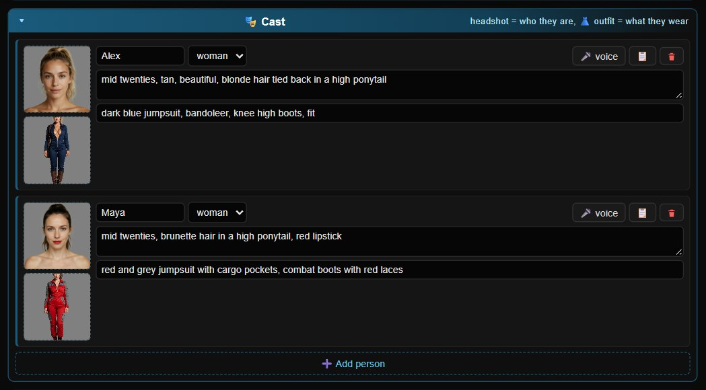

### Cast: one card per person
- **Name**: starts with a capital letter. Shots find people by this exact name.
- **who**: woman, man, girl, boy, person, cat, dog. It tells people apart.
- **look**: one line, head and hair only: age, face, eyes, skin, hair and its length. "mid twenties, a soft oval face, green eyes, light freckles, long wavy blonde hair".
    - ✋ No clothes (they go in the outfit picture) and no body words. The Story warns you (👗).
- **headshot** (the top square): head and hair, neutral face, on plain grey. Made with ✨ or your own picture.
    - ⚠️ **Your own picture? Rewrite the look to match it.** ✨ makes the headshot from the look, so the two agree. A picture you drop in keeps the old look, and H3 follows the words over the picture: "short dark hair" on a blonde headshot gives you short dark hair in every shot.
- **👗 outfit picture** (the square under it): the person head to toe in their outfit, from the **outfit notes** line.
    - **outfit notes**: the whole outfit in detail, with a color for every item. Start with the main piece: its first piece of clothing becomes the outfit's name for H3 ("dark blue jumpsuit").
- **🎤 voice** (optional): a 2 to 15 second clip of how they sound. H3 copies the voice, not the words.
- **📋** copies the name and look for another workflow.

### Picture slots: the same everywhere

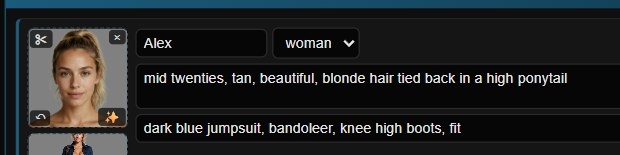

- Click a slot or drop a picture on it. The picker has **📚 Library** (102 ready-made pictures) and **⬆ Upload…**.
- Hover a filled slot for its buttons:
    - **✨** makes a new picture (section 8).
    - **↶** brings back the picture before (the last 8 are kept).
    - **✂** crops what the card uses (a head out of a full-length photo, just the coat of an outfit).
    - **×** empties the slot.
- ✋ Cast, outfit and prop pictures always end up on plain grey: the background comes off by itself, even on pictures you drop in.

### 👗 Outfits: a change of clothes

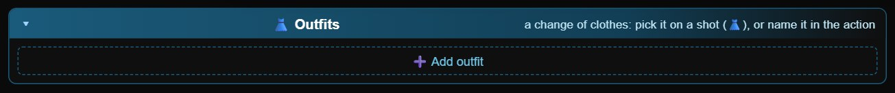

- ✋ **Everyone needs an outfit from somewhere.** The headshot carries none. The cast card's 👗 picture is what they wear from their first shot.
    - An outfit can also be a state of dress ("naked", "topless, black jeans"). H3 gets it as written.
- An **outfit card** is a change of clothes for one person:
    - **name**: simple, like a label in a store: "red cocktail dress", "gym clothes". With a picture, it's all H3 reads about the outfit.
    - **who wears it**: the person.
    - **description**: head to toe, a color with a shade for every item. Only the picture is made from it.
- **To change clothes:** pick the outfit on a shot (👗 dropdown), or name it in the action ("Nova comes back in the red dress"). They stay in it from that shot on.

---

## 6. Places 📍, 360 🌐 and props 👜

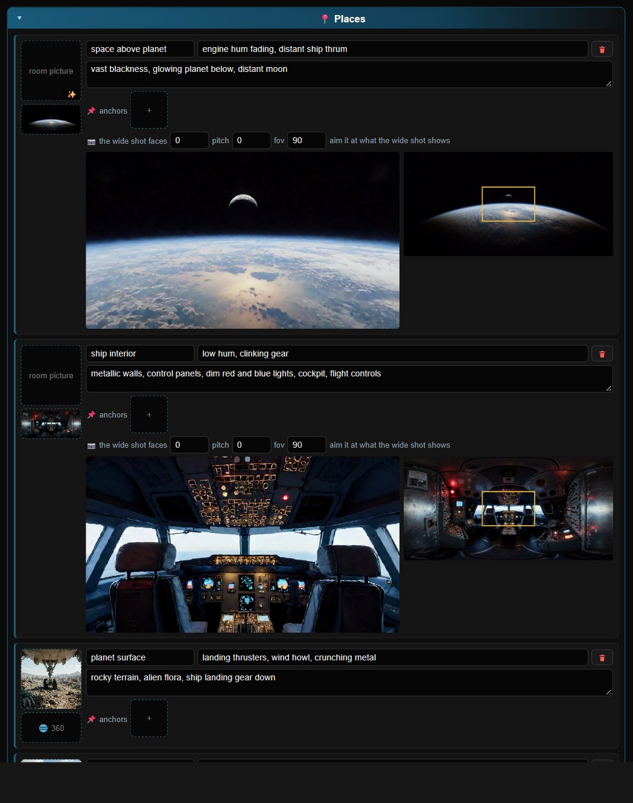

### Places: one card per location
- **name**: "the cafe". Shots pick their place by this name.
- **sound**: things you can hear: "rain on the glass, cups clinking". ✋ Never who speaks (no "nobody speaks"): naming speech makes H3 speak.
- **description**: the room, the furniture, the light.
- **room picture**: the place, **empty**. A person in it shows up in the movie.
- **🌐 360** (recommended): one panorama of the whole room. The Story cuts each shot's view out of it by itself.
    - **Set it once:** turn the small viewer until it shows what your wide shot shows (**📷 the wide shot faces**). That's "front".
    - Close-ups get their angle automatically: across a table they get the reverse angle, so the two people have opposite sides of the room behind them.
    - Want a different angle? Press **🌐 angle** on the shot and drag the view. Yours always wins.
- **📌 anchors**: frames that keep this room the same across cuts (section 12).

### Props: one card per object that matters

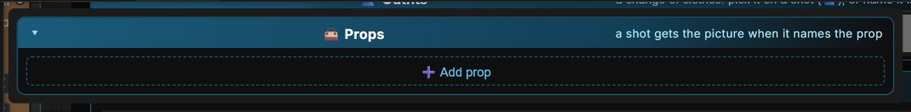

- Only for an object that must look the same in every shot (the red umbrella, the letter, the ring).
- ✋ Use the card's **exact name** in a shot's action, and that shot gets the prop's picture.

---

## 7. Shots 🎞

Top to bottom is the movie. One card per shot.

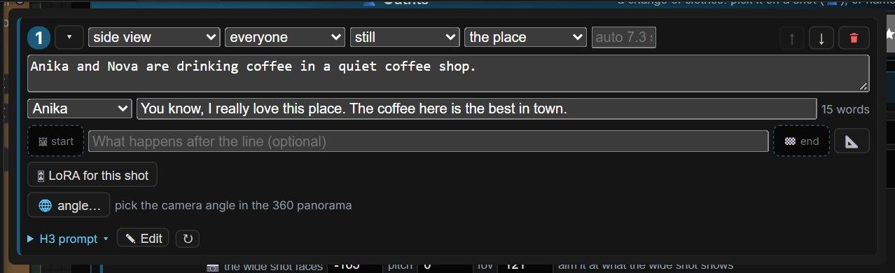

**The top row**
- **framing**: wide shot, side view, two-shot, medium shot, close-up, extreme close-up, over the shoulder, from behind, custom.
    - 💡 A face in a wide shot is tiny and can garble. When a face or a line matters, go medium or closer.
- **who it's on**: everyone, one person, or **nobody**.

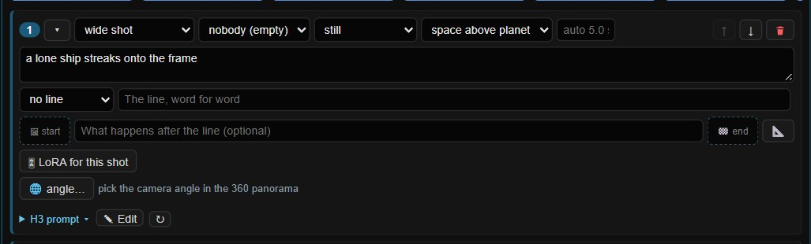

- **nobody** is an empty shot, the place alone (a ship coming out of hyperspace, an empty street). No faces are sent, and only a voiceover can speak.
- **move**: still, slow push-in, slow pull back, pan, tracking, orbit, handheld. Still is the safest.
- **✂ cut / 🎞 keep rolling** (from shot 2 on): see below.
- **where**: the place. "same place" = the shot before's.
- **seconds**: empty (auto) fits the action and the line. Type a number to set it, **auto** puts it back.
- **↑ ↓** move the shot, 🗑 removes it.

**The rest of the card**
- **action**: what happens before the line. Short sentences, present tense.
- **speaker** + **line**: who talks, and the words exactly as they say them. One line per shot. **(V.O.)** speakers are a voiceover: heard, lips closed.
- **after**: what happens after the line (optional).
- **🖼 start / 🏁 end**: the first or last frame of the shot (section 9).
- **📐**: boxes for who stands where (section 9).
- **🌐 angle**: aim this shot's camera inside the place's 360.
- **🎛 LoRA for this shot**: see below.

### 🎛 LoRA for this shot

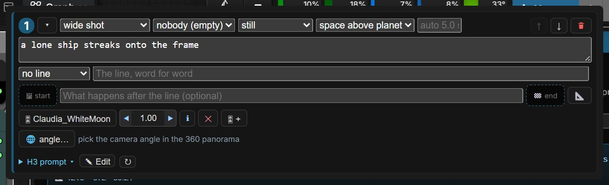

- Any LoRA, for **this shot only**: a character, an outfit, a backdrop, a style, an action, etc. It goes **on top of** the LoRAs in the pipe (turbo and the rest), and the next cut starts without it.
- **🎛 LoRA for this shot** adds a row. Pick the LoRA and the strength. **×** takes it off. Add as many as you like.
- A new row starts on "pick a LoRA…": nothing goes on until you choose it.

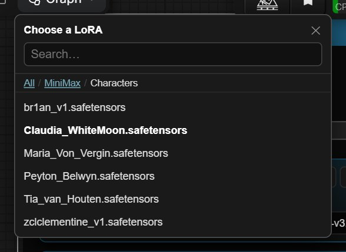 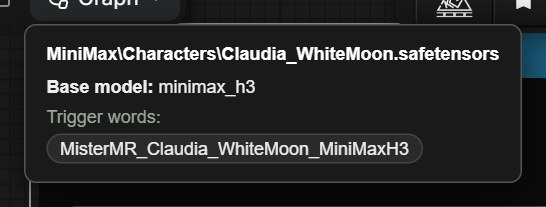

- **Keep rolling** uses the LoRAs of the shot it rolls from (🔒). A new LoRA in the middle of a roll jumps at the join.
- Change a LoRA or its strength and the shot's tile turns ✏️: Run makes it again.
- 💡 **Character LoRAs:** use the trigger word (usually the name) in the cast card's look and in the action. One per person.
    - A man and a woman with their own LoRAs in one shot held both faces in testing. Two women with LoRAs in the same shot tend to blend (one picked up the other's glasses). Give each one her own close-up.
- 💡 **Name the outfit.** A LoRA trained on less clothing brings less clothing unless the cast or outfit card says what they wear.

### ✂ Cut or 🎞 keep rolling

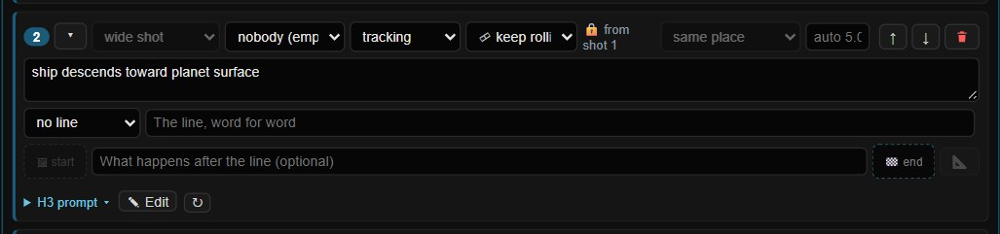

- **cut**: a new shot. It gets the faces, the outfits, the room and the anchor. Use it most of the time.
- **keep rolling**: no cut. The camera carries straight on from the end of the shot before, so the joins are seamless.
    - 🔒 The card **locks** what has to stay the same: framing, place, 🌐 angle, outfits, start frame and boxes (greyed out, "🔒 from shot N").
    - **Who is in it stays open**: people can walk in. They get their face and outfit pictures, so their faces are right.
    - Need a new framing? Change the shot it rolls from, or make this one a cut. H3 can't carry on into a new framing: it cuts by itself to a room it invents.
    - 💡 To get closer without a cut, keep rolling with the move **slow push-in**.

### Long stories: minimize shots

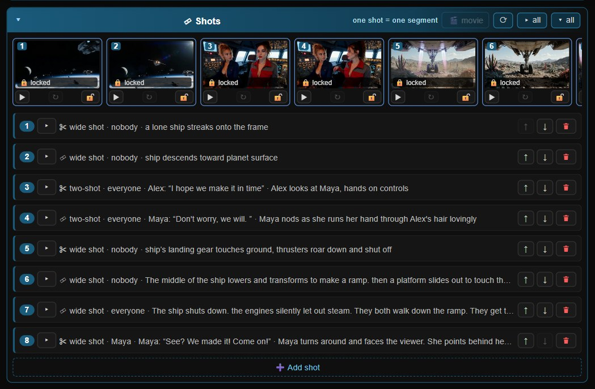

- **▾** next to a shot's number folds it to one line. **▸ all / ▾ all** in the Shots header fold or open every shot.
- It's only a view: nothing about the shot changes.

---

## 8. Making the pictures ✨

- Press **✨** on any picture slot. The Story switches on the part of **Cards & Storyboard 🃏** that makes it, keeps **Make** off, runs once and puts everything back. The picture lands on its card by itself.
- ✋ **Name the card first.** A blank name never writes over a picture.
- If the slot has a picture already, ✨ asks first, and the old one is kept (**↶**).
- What each slot makes:
    - **cast headshot**: head and hair, neutral face, plain grey (1024 x 1024).
    - **cast 👗 outfit**: the person head to toe in the outfit notes (896 x 1152).
    - **outfit card**: the description on an invisible mannequin, plain grey.
    - **room**: the place, empty (1344 x 768).
    - **🌐 360**: the room all the way round (2:1).
    - **prop**: the object alone, plain grey.
- 💡 Not happy? ✨ again: the seed changes every time.
- 💡 **Neutral faces only.** A smiling card gives you a smiling actor in every shot.
- 📚 **Or skip making them:** the Library tab in every picker has 102 ready-made cast headshots, outfits, props and 360 panoramas. Click one: it downloads once and lands on the card.

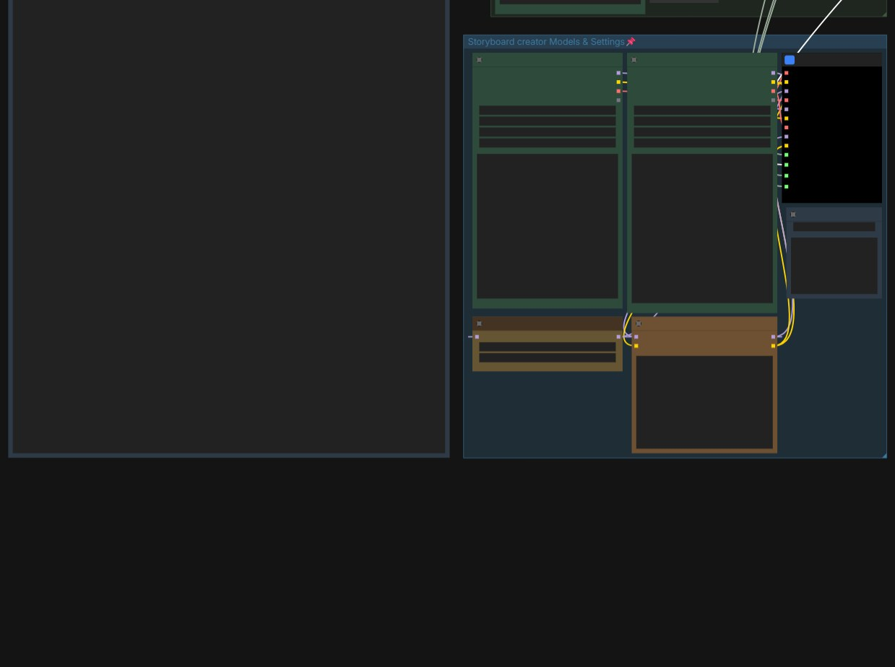

- The models sit in front of the box: **Card Model (Krea2)** with the **Character or Style LoRA**, **Storyboard model (MOSS)** and the **🪪 Edit LoRA**. Leave them on ★ Recommended unless you have your own.
- ✋ Don't rename the groups inside the box, and don't move nodes out of them: ✨ finds each part by its group name.

---

## 9. Storyboard 🗺️ (start frames)

The first frame of each shot, built from your cards, so every shot starts with the right people in the right room. Optional, recommended.

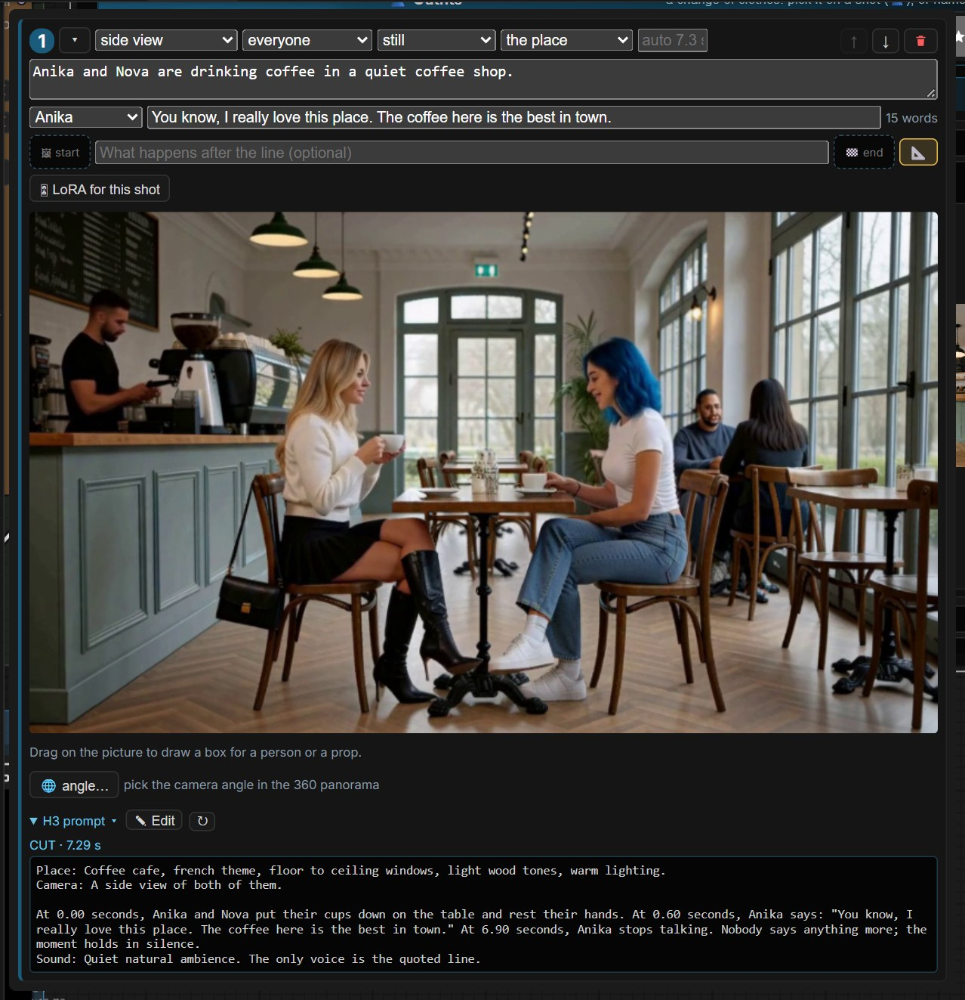

- Press **📐** on a shot and draw a box for each person (and prop) where they should be. Pick who each box is. Bigger box = closer to the camera.
- Press **✨** on the shot's **🖼 start**. MOSS lays the shot out from the boxes, then Krea 2 Identity Edit redraws it sharp with your cast. It lands in the slot.
- **🏁 end** works the same, for the frame a shot lands on.
- ✋ **H3 copies a start frame exactly.** A soft or wrong frame makes a soft or wrong shot. ✨ again, or ↶ for the one before.
- ✋ **The start frame is the action's first moment.** Nova already seated + "Nova comes back and sits down" gives a second Nova walking in.
- A later wide shot in a place you've already shown is built on the first wide's frame. ✋ **Box only who changes.**
- 🖼 start is for cuts. A keep rolling shot starts from the shot before.

---

## 10. Making the movie 🎥

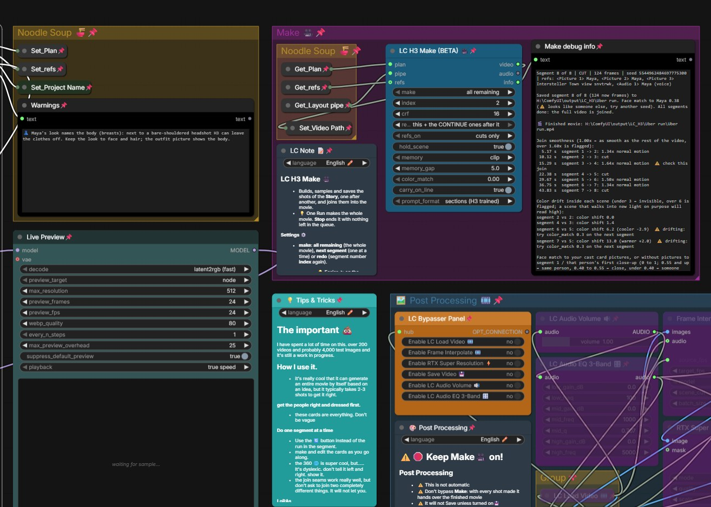

- Press **Run**. **Make** renders every shot that isn't made yet, one after another, and joins the movie as it goes.
- **Stop** ends it with nothing left in the queue. Run again and it picks up where it stopped.
- **Changed a shot?** It turns ✏️ on the board. Run remakes only the changed shots.
- **Changed the size?** Run remakes the shots made at the old size.
- **Make's info** after every shot:
    - **face match**: 0.55 and up = same person, 0.40 to 0.55 = close, under 0.40 = someone else (remake it).
    - **join**: how smooth each keep-rolling join is.
- ⚠️ Keep Make on. Don't bypass it.

---

## 11. The board: play, remake, lock

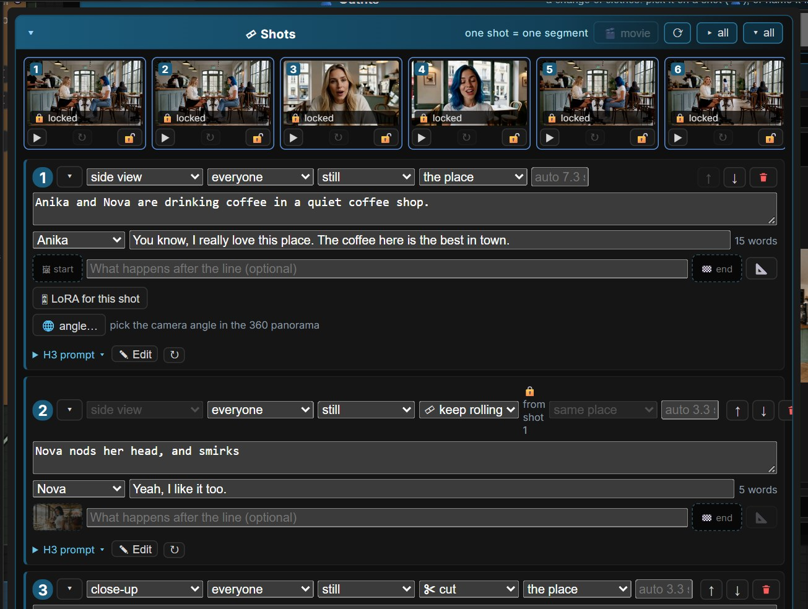

- One tile per shot, under the Shots header: ✅ made, ✏️ changed since it was made, 🔒 locked.
- **▶** plays the shot (its own part, without the bit it carries over from the shot before).
- **↻** makes **that one shot** again with a new seed, then stops. Nothing after it is touched, and the old take is kept in `takes/`.
    - 💡 A keep rolling shot right after it won't join smoothly until you ↻ it too.
- **🔒** locks a keeper so nothing remakes it.
- **🎬 movie** plays the whole movie. **⟳** looks for new takes.

---

## 12. Anchors 📌 and starting a shot from a frame 🖼

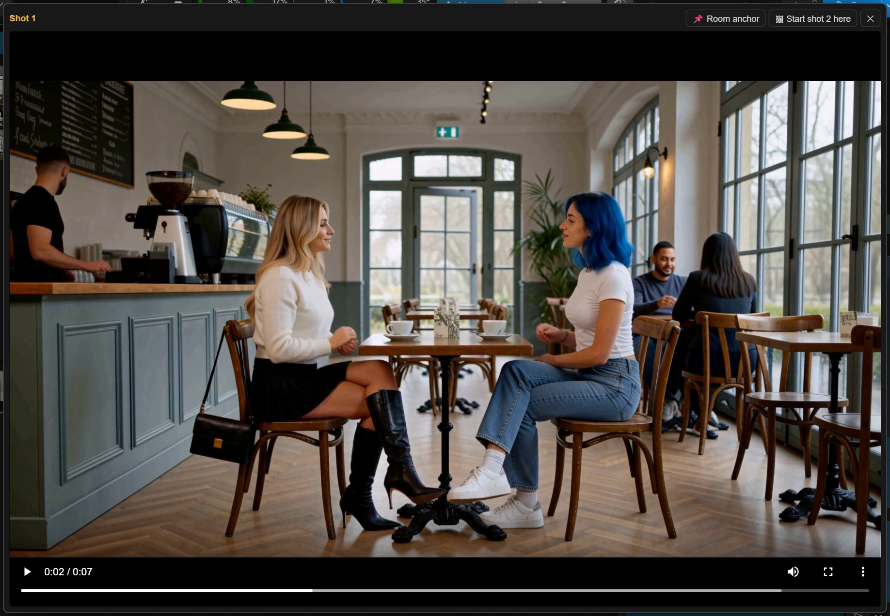

Play a shot (▶) and pause on a frame. Two buttons at the top:

- **📌 Room anchor**: this frame is shown to H3 as the room for later cuts in this place (who sits where, the furniture, the windows). It never starts a shot.
    - The button turns green and says which anchor it added. Add a few if you like.
    - Without anchors, H3 rebuilds the room on every cut: a new counter, a moved table, swapped seats.
    - Automatic too: the first wide shot made in a place becomes its anchor until you add your own.
- **🖼 Start shot N here**: this frame becomes the **next** shot's first frame, so the next shot opens exactly on it. A keep rolling next shot becomes a cut.
- 💡 Cutting back to a camera you already showed (same place, framing and person) opens on that shot's first frame by itself.

---

## 13. Post processing 🎞️

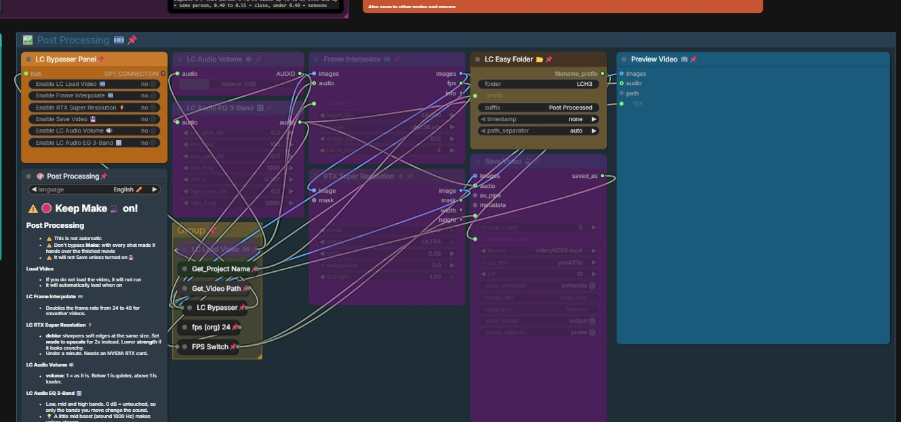

### ⚠️ It will not save unless **Save Video 💾** is switched on!

- 💡 Everything in this panel is normally off. Switch on only what you're using, and only once the movie is done.
- Keep **Make** on: with every shot made it just hands over the finished movie. Nothing renders again.
- It processes the whole movie at once and it's heavy, so only switch it on when the movie is done.
- Turn on what you want in the panel:
    - **Load Video**: needed for everything below.
    - **Frame Interpolate** 24 → 48: smoother motion, under a minute.
    - **RTX Super Resolution**: **deblur** sharpens soft edges at the same size. **upscale** makes it 2x instead. Needs an NVIDIA RTX card.
    - **Save Video 💾**: nothing saves without it.
    - **Audio Volume** and **Audio EQ**: louder or quieter, and a simple 3-band EQ for the voices.

---

## 14. Where everything is saved

```
📂 ComfyUI/
├── 📂 input/
│   └── 📂 lc_h3_refs/
│       └── 📂 <project>/
│           ├── cast_, dress_, outfit_, place_, pano_, prop_ pictures
│           └── start_ and end_ frames
└── 📂 output/
    └── 📂 LC_H3/ (the default, unless you changed it)
        └── 📂 <project>/
            ├── story.json, plan.json, size.json
            ├── <project>.mp4 (the finished movie)
            ├── 📂 views/ (the 360 angles)
            └── 📂 takes/
                ├── seg_001.mp4, seg_002.mp4, etc.
                └── old takes
```

- A new picture gets a number (`cast_Nova.png`, `cast_Nova_2.png`), so older ones are kept and a shot made from one never loses it.

**What to keep, what you can delete** (nothing is ever deleted until you do it)
- **Keep while you work:** `story.json`, the project's `lc_h3_refs` pictures, and everything in `takes/`. The next shot carries on from the files in there (the `_tail` and `_latent` files), and `cast_` files are each person's face and voice memory.
- **Safe to delete once the movie is finished:** the old takes (`seg_003_take1.mp4` and its `.json`), the `views/` folder (made again when needed), and numbered pictures you no longer use (`cast_Nova_2.png`).
- **A whole project:** delete its `output/LC_H3/<project>/` and `input/lc_h3_refs/<project>/` folders.

---

## 15. Troubleshooting

**Errors and basics**
- **Post processing fails or runs out of memory:** it runs on the whole movie at once. Turn on only what you need, one part at a time, and only when every shot is made.
- **✨ on a slot (or ✨ Write) does nothing, or waits:** something else is running. Let the movie finish, or Stop it, then press ✨ again. Only one job runs at a time.
- **Red node or "value not in list":** a model or LoRA file is missing or has a different name. Pick it again in the loader, or download it (the main notes have the links).
- **Out of memory on Make:** lower the size in ⚙️ Settings (960 x 544 is the low VRAM size) or shorten **max_shot_seconds**.

**The picture**
- **Blurry or soft:** too few steps. 12 with turbo at 0.7, or 8 with turbo at 1.0.
- **Hazy, washed out or grey:** turbo is off, or the steps don't match it. Use the settings above.
- **Burnt, too much contrast, or strange colors:** cfg is too high. Keep cfg at 1 with the turbo LoRA.
- **Noisy or unfinished:** too few steps for the settings. Go back to 12 with turbo 0.7.


**Faces**
- **A stranger's face:** the person has no headshot, or the action names someone with no cast card.
- **Faces change in a keep rolling shot where people walk in:** fixed in LC AV 0.5.17 (they now get their pictures). Remake the shot with ↻.
- **face match under 0.40:** ↻ the shot. If it keeps failing, it's the headshot or the look words.
- **Wrong hair or face on everyone's shots:** the look doesn't match the headshot (usually your own picture dropped on a card ✨ wrote). Rewrite the look to describe the picture.
- **Faces garbled in a wide shot:** a face there is tiny. Use a medium, two-shot or over-the-shoulder shot for anything with a face or a line.

**Clothes**
- **Clothes change every shot:** no 👗 outfit picture (the Story warns you).
- **People come out undressed:** body words in the look, or an outfit with no real name. Keep the look to head and hair, and name the outfit for what it is.
- **Colors drift between shots:** an item without a color. Give every item a color with a shade.

**Rooms and joins**
- **The room changes after a cut:** no anchor yet. Make the wide shot first, or 📌 a good frame from it.
- **A keep rolling shot jumps to a new room:** shouldn't happen anymore, the card locks the framing. If you need a new framing, make it a cut.
- **The shot opens on your start picture, then jumps to another room:** the picture isn't the shot's place. Give it its own place card.

**Sound and lines**
- **Speech in a silent shot:** speech words in the place's sound line. Sounds only.
- **The line is said twice:** spare time after it. Add an **after** beat.
- **Mouth doesn't move:** drinking or eating during the line. Put the sip in **after**.
- **The wrong person talks:** check the speaker. Don't reorder the cast after shots are made.

**The tool**
- **↻ didn't remake the shots after it:** that's on purpose. ↻ remakes one shot. Remake the next one too if it keeps rolling.
- **The movie has two sizes in it:** you changed the size mid-project. Run once more: the old-size shots are remade.
- **📌 didn't seem to do anything:** look for the green "Room anchor added" on the button. It only affects later cuts in that place.

---


*"True Nothing is. Permitted Everything is"*- Yoda Auditore, **Assassin's Wars**
